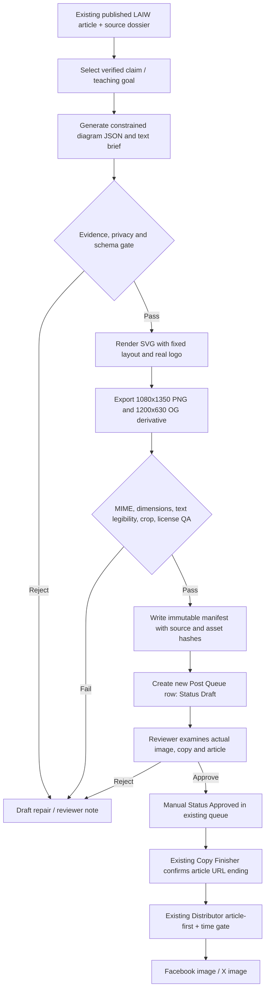

# LAIW: Branded Diagrams & Interactive Explainers — Existing Approval-Gate Integration

**Research/design date:** 2026-11-16 (America/Denver).  
**Status:** Architectural proposal, live system verified read-only; no n8n workflow, Google Sheets row, WordPress post, image, or social account was modified during this analysis.

## Decision in one paragraph

Implement a standalone, **draft-only LAIW Explainer Creative Factory** connected to the existing Google Sheets Post Queue and published LAIW WordPress articles. Its first deliverable is **one branded, source-verified 4:5 flowchart image** plus accessible article/alt text and channel copy. Keep the **existing manual Status=Approved gate, ArticleStatus=Published and article-link-completion guard**. Make carousel creation and clickable website diagrams optional later milestones. Interactive in-feed does **not** mean arbitrary HTML/JavaScript inside Facebook/X; this is either native swipe/comment/poll interaction or a real web experience on launchaiworks.com.

## Live systems inspected, November 16

| Component | Verified runtime | Interface constraint |
|---|---|---|
| Content Feeder | Active: `qROLaS3F14Glz2jN`, 117-node graph | Already drafts News/WorkingOn/Tool copy; Gemini & stock-image branches. Do not insert another expensive stage into this large branch for v1. |
| Article Engine | Active: `7bUPmQYjDo6KPn7J`, 23 nodes | `Pick Row` selects `Status` Approved/Posting/Posted/Partial with blank ArticleStatus, or ArticleStatus=Queued. If an explainer row references an existing published article, set ArticleStatus=Published explicitly to prevent a second WordPress article. |
| Copy Finisher | Active: `vIQGO8FtjjLn6dm5`, 23 nodes | For a published article: FB last line `🔗 Read more: <ArticleURL>`; X final URL `<ArticleURL>` within weighted 280 chars; retains evidence in article. It only processes Draft/Approved rows. |
| Social Auto-Distributor | Active: `H5RRejfcdYBpm1ii`, 42 nodes | Selects `Status=Approved` and due date; for News/Tool/WorkingOn nonvideo requires ArticleStatus Published, public launchaiworks.com URL and matching copy suffix; routes FB single-photo and X single image. **No current carousel publisher.** The distributor does not currently verify an immutable creative hash. |
| Queue | `1RaU9E4kKjYWo93HrbIpRg6gIVrMJAeQlO43wnzkYHAo`, tab Queue; 19 columns | QueueID, ContentTitle, CopyFacebook/X/YT, MediaDriveURL, MediaType, Platforms, ScheduledFor, Status, post URLs, ErrorNotes, SourceURL, ContentType, ArticleStatus, ArticleURL, ArticleNotes. No dedicated CreativeType/CreativeStatus/ManifestID columns. |
| WordPress SEO | `jmason84/laiw-seo-meta` | Existing OG/Twitter image from seo_image, featured image and fallback. Diagram HTML/SVG interactivity is NOT handled by this plugin. |

**Critical caveat:** Because an existing Approved row may already be eligible for the distributor once the published article and final link are ready, **never silently replace its image or caption while it is Approved**. In v1, create **new Draft companion posts** (or modify only still-Draft existing rows) and preserve original posts. Do not set Approved programmatically.

## Proposed workflow: LAIW — Explainer Creative Factory (inactive staging)

This is a proposed graph, not an exported n8n workflow already installed.

### Recommended v1 integration contract (no new public-platform credential)

- **Source selector:** choose a **public, actually Published** LAIW article with a suitable factual process explanation. Prefer content the business actually built or verified; never expose internal n8n workflow JSON, IPs, auth, client secrets, private data, internal GitHub code, real customer identities, or unapproved case results. An article may itself be insufficient evidence to claim an outcome; use links/citations.
- **Diagram planner:** output bounded JSON nodes and edges (3–6 nodes, 2–7 edges), evidence reference for every claim, layout type, one headline, 1–2 concise captions, descriptive alt text, brief CTA. Avoid generated text inside AI-image backgrounds; place exact text with deterministic typography.
- **Renderer:** use a scoped renderer (Mermaid CLI or SVG layout with Sharp/Playwright, or draw.io XML validated with XSD) operating on a scrubbed JSON diagram; export editable source privately and raster images for social. Don't make a public n8n webhook that accepts arbitrary HTML/SVG/JavaScript. Avoid a network-accessible unrestricted render service.
- **Safety/quality:** no free-form HTML in SVG; escape labels, validate allowed node types and dimensions; compile source with diagram whitelist; inspect actual rendered PNG, edge clipping, font sizing, logo visibility, contrast, file size, hashes, alt text, photo rights and representative claim accuracy. Output ideally 1080x1350 4:5 for FB feed and 1200x630 for website OG; X crop/attachment must be viewed in a separate preview; test platform specifications.
- **Private manifest:** store original article URL/post ID, ParentQueueID (if a companion), claim references, editable diagram JSON/Mermaid source, renderer version, style, source/asset hash, expected PNG file ID, alt, image license/ownership, review status, reviewer and timestamp. Use a sidecar Google Sheet/Data Table, NOT changing the existing 19-column Queue schema for v1 and not storing source rights solely in ErrorNotes.
- **Queue handoff for a new companion:** create **new globally unique QueueID**, `Status='Draft'`, `MediaType='image'`, `MediaDriveURL` to the *verified* publishable image, `Platforms='FB,X'` only, `ContentType` inherited from News/Tool/WorkingOn (the existing gate recognizes these), `ArticleStatus='Published'`, `ArticleURL` the same public LAIW article; append final link in FB/X copy or let Copy Finisher deterministically complete it. SourceURL and Title are fixed and ownership-checked. **Do not mark ArticleStatus='Queued'** (that could cause a new article to be created without the intended review). New companion is a separate editorial choice; dedupe by article URL + creative type + content revision and avoid flooding the schedule.
- **Approval boundary:** the sidecar reviewer may approve the *visual asset* while the Queue row remains Draft. The existing human action changing the Queue Status to Approved remains the **only permission to post**. A later staged upgrade can make distributor verify approved asset SHA/manifest ID, but current distributor lacks that guarantee.
- **Separate content formats:** static diagram via current FB/X routes, 2–5 image carousel via future FB multi-photo or IG carousel adapter, native X poll **separate and text-only**, native story quizzes/polls only when platform eligibility and API support verified, interactive diagram hosted on article page (HTML/SVG with accessible controls) behind the LAIW site URL.
- **Idempotency:** atomically claim a published article/creative version; at most one companion draft per key and no duplicate QueueID; on a stale Queue row, abort patch unless QueueID+ContentTitle+SourceURL still match exactly. Never directly overwrite a live Approved/Posting/Posted row. The current feeder has a history of a Q-058 cross-write; preserve its fix.

## Example first series: “How we built LAIW's approval-first publishing”

Candidate actual article from Queue Q-002: https://launchaiworks.com/distribution-machine-small-business-automation/ . **Verify public article page and its sourced claims before using it as a production example.** This is a good concept because the existing LAIW system itself provides a documented use case; keep system internals abstract to protect secrets.

- **Post image 1 — Diagram cover:** “One Queue. One Approval. Several Channels.” (short brand headline, no outcome statistics).
- **Post image 2 — Before / after:** Before: copy/paste drafts and manual status checks; After: draft queued, human decision, article/public link verified, platform jobs recorded. Only call out time savings when measured.
- **Post image 3 — Step flow:** Idea/source → Draft → Human approval → Publish verified article → Enrich final social links → Distribute and record results. Keep captions faithful to the actual article-first trigger and failure/hold semantics.
- **Post image 4 — Guardrails:** Block missing copy, wrong article link, missing image, insufficient review or stale asset version (label any not-yet-built guard as *proposed*, not currently deployed).
- **Post image 5 — Reader participation:** “Which step would you want to automate—and where would you keep a human approval?” CTA to the original article on LAIW.

These may be condensed to **one initial 4:5 diagram** for the lowest-risk pilot. Interactive website follow-on: clickable stages in the article with expandable “What the automation does” / “What a person verifies,” keyboard accessibility, sanitized source data, analytics events and link to actual service pages. A social graphic itself does not contain working HTML controls.

## Platform capability and scope, confirmed from public documentation

- Facebook **multi-photo Page feed posts** are supported through uploading each unpublished photo to `/{page-id}/photos` and posting a `/{page-id}/feed` message with `attached_media` IDs. Source: https://developers.facebook.com/docs/graph-api/reference/page/photos/ . The current LAIW distributor only implements single-photo posting; the multi-photo adapter is **future work**.
- Instagram professional accounts support carousel media containers via Meta Graph API, subject to account connection, permissions, media hosting, ratio, async readiness and version. Source: https://developers.facebook.com/docs/instagram-platform/content-publishing/ . No verified LAIW Instagram posting integration was found in the inspected active distributor.
- X's native poll is genuinely interactive but **cannot include photos in that poll**. Its duration ranges from five minutes to seven days. Source: https://help.x.com/en/using-x/x-polls . A diagram post can instead ask followers to reply A/B, or link to an interactive quiz on LAIW; do not claim one X poll can be posted with an attached diagram.
- n8n template https://n8n.io/workflows/2378-visualize-your-n8n-workflows-with-mermaidjs/ supports Mermaid-based interactive documentation; treat as a rendering reference, not a secure public window into internal workflows.
- draw.io supports AI-generated editable XML diagrams (validated structure) and Mermaid conversion. Sources: https://www.drawio.com/docs/reference/diagram-generation/ and https://www.drawio.com/docs/manual/mermaid/ .
- n8n article-to-carousel with approval and visuals: https://n8n.io/workflows/22214-create-instagram-and-facebook-carousels-from-articles-with-claude-openai-and-slack/ ; this template's direct publishing is NOT acceptable as-is for LAIW.
- n8n human-in-loop workflows: https://blog.n8n.io/human-in-the-loop-automation/ and https://n8n.io/workflows/9402-create-multi-platform-social-media-content-with-sonnet-45-gotohuman-approval-and-sheets/ .

## Acceptance tests before any v1 live handoff

1. **Evidence:** diagram text matches a verified article/source; false numeric claims, real-customer specifics and fake product UIs are rejected.
2. **Rendering:** actual 1080x1350 PNG and 1200x630 OG preview checked for dimensions, cropping, text legibility and brand/logo preservation; file header is image not error JSON.
3. **Security:** raw n8n export/IP/credential/client details never reach diagram source; unsafe HTML, external SVG scripts and unsanitized links fail closed.
4. **Rights:** owner/source of every image/screenshot/font recorded; no implicit rights from an OpenAI image proxy.
5. **Idempotency:** replay/retry creates no duplicate draft or duplicate QueueID; stale row mutation fails unique ID+Title+SourceURL gate.
6. **Approval:** production queue row remains Draft through rendering and visual review; no external platform request is made before explicit Queue Approved.
7. **Article first:** published article URL is a real public LAIW URL; FB/X copy ends with existing exact article-link syntax, and blocked cases cannot publish.
8. **Rollback:** feature flag / workflow inactive to disable; original feeder/Article Engine/Copy Finisher/distributor untouched until a separate, tested approval-gate adapter is explicitly accepted.
9. **Metrics baseline:** record human time to create image and approve, creative QA failures, rendered cost, and seven-day article clicks/conversions. No asserted engagement lift without a controlled LAIW pilot.

**Next engineering milestone:** First build an *inactive* non-publishing staging workflow that takes the known Q-002 article, creates a validated 4:5 process diagram and 1200x630 preview, saves a versioned private review asset + manifest, and proves all QA gates with synthetic/negative tests. No Facebook, X, IG or WP publish action in that workflow. Only after that, test the companion-Draft Queue append, then ask the owner to approve the actual artwork before social posting.

## Related durable documentation

- Static/image posting research and QA: https://github.com/jmason84/laiw-seo-meta/blob/main/docs/STATIC_IMAGE_POST_RESEARCH_AND_QA_2026-11-15.md
- Canonical LAIW handoff: https://docs.google.com/document/d/1zloMmJVSwOLMdAfWe27i9q62gPBS6efBVH9S5Q_OqbM/edit
- Content feeder master plan: https://docs.google.com/document/d/1sxwjJeY78hmAVHlJQC7JOs4FrvZsQs2qxiTULu9tQws/edit

**Evidence limit:** This planning pass inspected live n8n graphs and Queue schema read-only, plus current public provider docs/templates. No staging diagram has been rendered, no approved creative has been modified, and no new platform publishing route has been tested or deployed.
